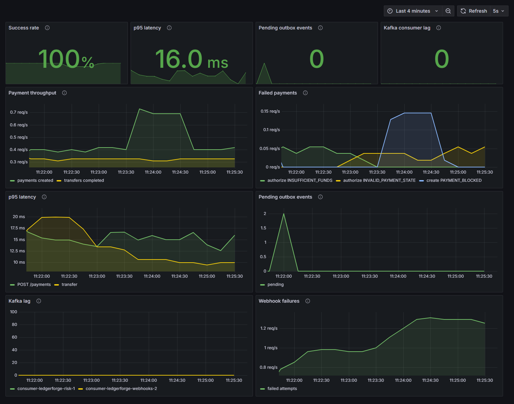

# LedgerForge

**Production-style payment and double-entry ledger platform built with Java 21 and Spring Boot.**

Designed around the problems that make financial systems difficult:

- transactional consistency
- concurrent balance updates
- idempotent requests
- immutable double-entry accounting
- reliable asynchronous event delivery
- failure recovery

**Java 21 • Spring Boot 4 • PostgreSQL • Kafka • Redis • Testcontainers • Docker • Prometheus • Grafana**

[](https://github.com/kgiannopoulou/Java-Transaction-Payment-Platform/actions/workflows/ci.yml)
[](https://github.com/kgiannopoulou/Java-Transaction-Payment-Platform/actions/workflows/codeql.yml)
[](docs/failure-scenarios.md)


```bash
docker compose --profile demo up
```

Then open [Swagger UI](http://localhost:8080/swagger-ui.html) and the [Grafana dashboard](http://localhost:3002).

---

## Architecture

```
            HTTPS + Bearer JWT
                │
┌───────────────▼──────────────────────────────────────────────────────┐
│ Spring Boot 4 · Tomcat on virtual threads                            │
│  security: JWT filter → role gates → @PreAuthorize ownership checks  │
│  rate limits (Redis) → risk engine (rules) → business transaction    │
│                                                                      │
│  customer  account  ledger  transfer  payment  idempotency  audit    │
│  ── each: api / application / domain / infrastructure ──             │
│  outbox (relay)   risk + webhook (Kafka consumers)   messaging       │
│  webhook dispatcher ───────────────────────► customer HTTPS (signed) │
│  shared: Money · errors · events · RetryingTransactionExecutor       │
└───┬───┬──────────────────────────────────────────────▲───────────────┘
    │   │ JDBC (one transaction per command)           │ consume
    │ ┌─▼────────────────────────────────┐   relay   ┌────┴─────────────────┐
    │ │ PostgreSQL 17 · Flyway           │ ────────► │ Kafka 4.1 (KRaft)    │
    │ │  the source of truth             │           │  payments.v1 (+.DLT) │
    │ │  accounts · ledger (append-only) │           │  transfers.v1 (+.DLT)│
    │ │  transfers · payments            │           │  accounts.v1  (+.DLT)│
    │ │  idempotency · audit_events      │           └──────────────────────┘
    │ │  outbox · processed_events       │
    │ │  risk_alerts · risk_decisions    │
    │ │  webhook endpoints + deliveries  │
    │ └──────────────────────────────────┘
    │
  ┌─▼──────────────────────────────┐
  │ Redis 7: disposable by design  │
  │  rate limits · ownership cache │
  │  risk counters and signals     │
  └────────────────────────────────┘
```

Every money movement follows one path:

```
authenticate (JWT) → authorize (role + ownership) → rate limit and risk screening (new payments)
   → lock accounts (sorted, FOR UPDATE)
   → validate under lock → LedgerService.post → balanced LedgerTransaction (DEBIT + CREDIT)
   → balances updated → INSERT audit_event → INSERT outbox_event → COMMIT
   → PostgreSQL re-checks Σ debits = Σ credits at commit
   → (later) outbox relay → Kafka → risk alerts / webhook fan-out (idempotent)
   → (later) webhook dispatcher → signed HTTP to the customer, with retries
```

If any step before COMMIT fails, **everything** rolls back: business record, ledger entries,
balances, idempotency key, audit event and outbox event.

## Key engineering guarantees

| | Guarantee | Proof |
|---|-----------|-------|
| ✓ | Every financial transaction balances to zero | a deferred PostgreSQL trigger rejects anything else at commit; [`LedgerDatabaseGuaranteesTest`](src/test/java/com/kgiannopoulou/ledgerforge/api/LedgerDatabaseGuaranteesTest.java) |
| ✓ | Concurrent requests cannot overspend an account | 100 simultaneous withdrawals of the whole balance: 1 succeeds; [`PessimisticLockingConcurrencyTest`](src/test/java/com/kgiannopoulou/ledgerforge/concurrency/PessimisticLockingConcurrencyTest.java) |
| ✓ | Retried requests cannot create duplicate payments | 100 identical concurrent requests create one transfer; [`IdempotencyApiTest`](src/test/java/com/kgiannopoulou/ledgerforge/api/IdempotencyApiTest.java) |
| ✓ | Database commits cannot silently lose Kafka events | the event commits with the change; [`OutboxRecoveryTest`](src/test/java/com/kgiannopoulou/ledgerforge/outbox/OutboxRecoveryTest.java), and [Kafka killed mid-payment](docs/failure-scenarios.md) |
| ✓ | Duplicate Kafka delivery cannot duplicate side effects | consumers deduplicate in the same transaction; [`ConsumerFailureHandlingKafkaTest`](src/test/java/com/kgiannopoulou/ledgerforge/events/ConsumerFailureHandlingKafkaTest.java) |
| ✓ | Failed webhook deliveries are retried safely | 10 s, 30 s, 2 min, with every attempt stored; [`WebhookDeliveryTest`](src/test/java/com/kgiannopoulou/ledgerforge/webhook/WebhookDeliveryTest.java) |
| ✓ | PostgreSQL remains the authoritative financial state | ArchUnit keeps the financial core away from Redis; [Redis killed mid-payment](docs/failure-scenarios.md) changes nothing |

## Engineering Challenges

Four problems that shaped this project, each with a test that reproduces the failure.

### 1. Preventing overspending

```
100 concurrent withdrawals of the whole balance
              ↓
   row-level locks, in a fixed order
              ↓
        exactly one succeeds
```

A read-modify-write looks correct and passes every sequential test. Under concurrency, two requests
read €100, both see enough money, and both pay out. `NaiveLockingRaceTest` keeps that bug alive on
purpose: 20 of 20 withdrawals of €10 "succeed" against a €100 wallet.

The fix is `SELECT ... FOR UPDATE` before checking the balance. Locks are taken in ascending id order,
because A→B racing B→A would otherwise deadlock, and every check runs after locking, because checking
first is still a race. Result: 1 × `201` and 99 × `422`, and 200 opposing transfers finish with no
deadlocks. [Concurrency notes](docs/concurrency.md) · [ADR 003](docs/decisions/003-pessimistic-locking.md)

### 2. Preventing duplicate transfers

```
network timeout
      ↓
client retries
      ↓
idempotency key
      ↓
same transaction returned
```

After a timeout the client cannot know whether the money moved, so it has to retry, and the server has
to make that safe. The `Idempotency-Key` row is written in the **same transaction** as the transfer, so
a key can never be completed without its money movement, or the reverse. A separate store would leave
a gap for exactly the crash this is meant to survive. Concurrent duplicates block on the key row and
then replay the stored response. [Idempotency notes](docs/idempotency.md) · [ADR 009](docs/decisions/009-idempotency-in-the-business-transaction.md)

### 3. Reliable Kafka events

```
database commit
      +
outbox insert
      ↓
same transaction
      ↓
event eventually reaches Kafka
```

Writing to PostgreSQL and then Kafka is a dual write: crash in between and the event is gone, with no
trace. So nothing writes to Kafka directly. The event is a row in the business transaction, and a
relay publishes it afterwards. Delivery becomes at-least-once, so consumers deduplicate on the event
id. When Kafka is killed, payments keep working and the events wait in PostgreSQL.
[Outbox notes](docs/outbox.md) · [ADR 004](docs/decisions/004-transactional-outbox.md)

### 4. Maintaining financial invariants

```
Debit  €50
Credit €50
Net =  €0
```

`balance = balance - 50` leaves no history and proves nothing. Every movement here is a balanced ledger
transaction, and the rule is enforced three times: in Java, by a deferred PostgreSQL trigger at commit,
and by append-only triggers that forbid editing history. Tests then attack it: raw SQL tries to bypass
Java, and 5,000 random concurrent transfers among four €1000 wallets must always total exactly €4000.
[Ledger invariants](docs/ledger-invariants.md) · [ADR 002](docs/decisions/002-double-entry-ledger.md)

## Quick start

Requirement: **Docker**. Nothing else needs installing.

```bash
docker compose up                # the whole platform
docker compose --profile demo up # the same, plus generated traffic so the dashboards have data
```

The first start builds the image and takes a few minutes.

| Service | Address | |
|---------|---------|---|
| **LedgerForge API** | <http://localhost:8080> | dev tokens enabled, see the walkthrough below |
| **Swagger UI** | <http://localhost:8080/swagger-ui.html> | try the API in the browser; the first page explains how to get a token |
| **Grafana** | <http://localhost:3002> | opens on the dashboard, no login |
| **Prometheus** | <http://localhost:9091> | |
| PostgreSQL | `localhost:5437` | user and password `ledgerforge` |
| Kafka | `localhost:9094` | |
| Redis | `localhost:6382` | |

If a port is taken: `LEDGERFORGE_HTTP_PORT`, `LEDGERFORGE_GRAFANA_PORT` and `LEDGERFORGE_PROMETHEUS_PORT`
change the first three. `docker compose down -v` removes everything.

These settings are for a local demo: dev tokens, plain HTTP webhooks, anonymous Grafana and a
fixed metrics password must never reach a real deployment.

For development (needs **JDK 21**):

```bash
# Run the app locally against the Compose infrastructure
docker compose up -d postgres kafka redis  # PostgreSQL on :5437, Kafka on :9094, Redis on :6382
LEDGERFORGE_DEV_TOKENS=true ./mvnw spring-boot:run

# Full test suite (unit, integration, security, concurrency, Kafka, Redis, architecture).
# Needs Docker for Testcontainers (PostgreSQL 17, Kafka 4.1, Redis 7).
./mvnw verify

# Just the unit tier: seconds, no Docker
./mvnw test -DexcludedGroups=integration
```

> The migrations were reorganised once, before any deployment ([ADR 015](docs/decisions/015-migration-layout-and-rebaseline.md)).
> If you have a local database from an earlier version, recreate it: `docker compose down -v`.



## What this project demonstrates

| Area | Where to look |
|------|---------------|
| **Concurrency**: lost updates reproduced, then prevented with row locks + deterministic lock ordering; optimistic locking with retries as an alternative | [`docs/concurrency.md`](docs/concurrency.md), [`concurrency/`](src/test/java/com/kgiannopoulou/ledgerforge/concurrency) |
| **Double-entry ledger**: balanced, append-only, enforced by Java *and* PostgreSQL triggers, with raw-SQL reconciliation | [`docs/ledger-invariants.md`](docs/ledger-invariants.md), [`V003__create_ledger.sql`](src/main/resources/db/migration/V003__create_ledger.sql) |
| **Idempotency**: `Idempotency-Key` stored in the same transaction as the money movement; 100 identical concurrent requests → 1 transfer | [`docs/idempotency.md`](docs/idempotency.md) |
| **Modern Java**: records, sealed interfaces + exhaustive pattern-matching `switch`, `BigDecimal` money, virtual threads, streams | [`Money`](src/main/java/com/kgiannopoulou/ledgerforge/shared/money/Money.java), [`PaymentCommand`](src/main/java/com/kgiannopoulou/ledgerforge/payment/domain/PaymentCommand.java), [`PaymentService`](src/main/java/com/kgiannopoulou/ledgerforge/payment/application/PaymentService.java) |
| **Spring**: MVC, Bean Validation, Data JPA, transactions (propagation, isolation, programmatic retry), configuration properties, RFC 9457 problem details | [`docs/architecture.md`](docs/architecture.md) |
| **Databases**: Flyway migrations, defence-in-depth constraints (raw-SQL tested), composite foreign keys, partial unique indexes, deferred constraint triggers, `SELECT … FOR UPDATE`, `ON CONFLICT`, `REPEATABLE READ` | [`docs/database-design.md`](docs/database-design.md), [`db/migration`](src/main/resources/db/migration) |
| **Error handling**: sealed `DomainException` hierarchy, named exceptions (`InsufficientFundsException`, `AccountFrozenException`, `PaymentAlreadyCapturedException`, …), one `@RestControllerAdvice`, consistent error body with `traceId`, no stack traces leaked | [`docs/error-handling.md`](docs/error-handling.md), [`ApiExceptionHandler`](src/main/java/com/kgiannopoulou/ledgerforge/shared/web/ApiExceptionHandler.java) |
| **Security**: Spring Security JWT resource server; `CUSTOMER` / `SUPPORT` / `AUDITOR` / `ADMIN`; role gates + per-resource ownership checks; tested over HTTP (Alice → Bob's account = 403) | [`docs/security.md`](docs/security.md), [`AuthorizationApiTest`](src/test/java/com/kgiannopoulou/ledgerforge/security/AuthorizationApiTest.java) |
| **Audit trail**: append-only (`UPDATE`/`DELETE`/`TRUNCATE` rejected by triggers), written in the business transaction, with actor and trace id | [`docs/audit-trail.md`](docs/audit-trail.md), [`V008__create_audit_events.sql`](src/main/resources/db/migration/V008__create_audit_events.sql) |
| **Events**: typed event records on a sealed interface; **transactional outbox** solves the dual write; Kafka consumers with retries, exponential backoff, DLT and **idempotent processing** | [`docs/outbox.md`](docs/outbox.md), [`events/`](src/test/java/com/kgiannopoulou/ledgerforge/events) |
| **Webhooks**: HMAC-signed, 10 s → 30 s → 2 min backoff, whole-request timeout, every attempt stored in an append-only table, dead-letter state with replay, `SKIP LOCKED` dispatcher, SSRF protection, secrets encrypted at rest | [`docs/webhooks.md`](docs/webhooks.md), [`WebhookDispatcher`](src/main/java/com/kgiannopoulou/ledgerforge/webhook/application/WebhookDispatcher.java) |
| **Redis, with a reason**: atomic sliding-window rate limits (429 + `Retry-After`), distributed counters, temporary risk signals, a cache of immutable data. No balances: ArchUnit keeps the financial core away from it, and a test kills Redis mid-payment | [`docs/redis.md`](docs/redis.md), [`RedisOutageTest`](src/test/java/com/kgiannopoulou/ledgerforge/redis/RedisOutageTest.java) |
| **Risk engine**: `RiskRule` interface, polymorphic rules injected by Spring, ALLOW / REVIEW / BLOCK, a review workflow, every decision stored and explainable | [`docs/risk-engine.md`](docs/risk-engine.md), [`rules/`](src/main/java/com/kgiannopoulou/ledgerforge/risk/application/rules) |
| **Testing**: unit, integration and end-to-end tiers on real PostgreSQL, Kafka and Redis, plus property tests: thousands of random transfers among four €1000 wallets, and the total is always €4000 | [`docs/testing.md`](docs/testing.md), [`property/`](src/test/java/com/kgiannopoulou/ledgerforge/property) |
| **Observability**: Prometheus metrics, a provisioned Grafana dashboard (throughput, success rate, p95 latency, failures, Kafka lag, outbox backlog), alert rules, health probes | [`docs/observability.md`](docs/observability.md), [`monitoring/`](monitoring) |
| **Logging**: structured JSON with `traceId`, `customerId`, `paymentId`, `transferId`; tests read real log events to prove that tokens, secrets and personal data stay out | [`docs/logging.md`](docs/logging.md), [`StructuredLoggingTest`](src/test/java/com/kgiannopoulou/ledgerforge/observability/StructuredLoggingTest.java) |
| **Architecture**: package-by-feature modular monolith, rules enforced by ArchUnit | [`ArchitectureTest`](src/test/java/com/kgiannopoulou/ledgerforge/architecture/ArchitectureTest.java), [ADRs](docs/decisions) |
| **API documentation**: OpenAPI and Swagger UI covering authentication, idempotency, errors, pagination and rate limits, generated from rules and checked by tests | [`OpenApiConfiguration`](src/main/java/com/kgiannopoulou/ledgerforge/infrastructure/OpenApiConfiguration.java) |
| **Performance**: k6 load tests from 50 to 1000 users, with measured results, including what went wrong | [`performance/`](performance/README.md) |
| **Failure testing**: Kafka, the application and PostgreSQL are killed with `SIGKILL` under load, and the books are checked | [`docs/failure-scenarios.md`](docs/failure-scenarios.md) |
| **CI**: compile, Checkstyle, unit, integration, concurrency and E2E stages, JaCoCo, CodeQL, dependency scanning | [`ci.yml`](.github/workflows/ci.yml) |
| **Operations**: Docker multi-stage layered image, one-command Compose stack (PostgreSQL, Kafka KRaft, Redis, Prometheus, Grafana), health probes, structured JSON logs, GitHub Actions CI | [`Dockerfile`](Dockerfile), [`compose.yaml`](compose.yaml), [`ci.yml`](.github/workflows/ci.yml) |

## The headline result

Concurrent transfer tests exposed lost-update scenarios in a naive read-modify-write
implementation. LedgerForge uses database row locking for balance-critical operations, with
deterministic account lock ordering to prevent deadlocks. The suite runs the same attacks
against each strategy (numbers from `mvn verify`):

| Attack | Naive read-modify-write | Pessimistic (default) |
|--------|-------------------------|-----------------------|
| 20 × withdraw €10 from a €100 wallet | **20/20 "succeed"**: €200 paid out of €100; stored balance €90, ledger says −€100 | 10 succeed, 10 refused |
| 100 × withdraw €100 from a €100 wallet | – | **1 × 201, 99 × 422**, balance €0.00 |
| 500 random transfers among 10 wallets holding €1000 | – | total is still **€1000.00**; ledger reconciles |
| 100 × A→B interleaved with 100 × B→A | – | 200/200 succeed, **no deadlocks** |
| 100 × same request, same `Idempotency-Key` | – | **one** transfer; 99 responses replayed |

Optimistic locking passes the same correctness tests, at the cost of ~6 retries per request on a
hot account (234–244 retries across runs for 40 concurrent transfers). See [`docs/concurrency.md`](docs/concurrency.md).

The event pipeline is tested the same way, by staging failures on a real broker:

| Situation | Result |
|-----------|--------|
| The same `PaymentCaptured` delivered twice | processed **once**: one webhook delivery, one risk alert |
| Consumer failing twice | retried with exponential backoff, processed **once** |
| Consumer failing for good | 1 + 3 attempts, then `ledgerforge.payments.v1.DLT` with the original payload; no side effects; risk scoring unaffected |
| Malformed record | straight to the DLT, no retries |
| Transfer rejected (insufficient funds) | no ledger entries, **no audit event, no outbox event** |
| Merchant endpoint failing 3 times | retried after 10 s, 30 s and 2 min, delivered on attempt 4, **all 4 attempts stored** |
| Merchant endpoint down for good | 6 attempts, then `DEAD`; replayable by the owner once it is fixed |
| 8 dispatchers, 200 deliveries | **200 requests, no duplicates** (`FOR UPDATE SKIP LOCKED`) |
| 150 concurrent payments on one account | exactly **100** pass the rate limit, 50 get `429` |
| 30 concurrent attempts on one account | exactly **19** allowed, 11 blocked |
| Redis killed during a payment flow | payments still work, balances correct, ledger reconciles |
| Kafka down during transfers | the API keeps working; after recovery every event is delivered, in order |
| Relay crashes after Kafka's ack | the event is sent again with the same id, never lost |
| 5,000 random concurrent transfers, 4 wallets, €4000 | total is exactly **€4000.00**, no wallet negative |

## API walkthrough

```bash
J='Content-Type: application/json'
token() { curl -s localhost:8080/api/v1/auth/token -H "$J" -d "$1" | jq -r .accessToken; }  # dev only

# 0. An operator token
ADMIN="Authorization: Bearer $(token '{"subject":"ops","roles":["ADMIN"]}')"

# 1. Customers and wallets (onboarding is an ADMIN operation)
ALICE=$(curl -s localhost:8080/api/v1/customers -H "$J" -H "$ADMIN" \
  -d '{"email":"alice@example.com","fullName":"Alice"}' | jq -r .id)
BOB=$(curl -s localhost:8080/api/v1/customers -H "$J" -H "$ADMIN" \
  -d '{"email":"bob@example.com","fullName":"Bob"}' | jq -r .id)
AL="Authorization: Bearer $(token "{\"subject\":\"$ALICE\",\"roles\":[\"CUSTOMER\"],\"customerId\":\"$ALICE\"}")"
BO="Authorization: Bearer $(token "{\"subject\":\"$BOB\",\"roles\":[\"CUSTOMER\"],\"customerId\":\"$BOB\"}")"

A=$(curl -s localhost:8080/api/v1/accounts -H "$J" -H "$AL" \
  -d "{\"customerId\":\"$ALICE\",\"currency\":\"EUR\"}" | jq -r .id)
B=$(curl -s localhost:8080/api/v1/accounts -H "$J" -H "$BO" \
  -d "{\"customerId\":\"$BOB\",\"currency\":\"EUR\"}" | jq -r .id)

curl -s -o /dev/null -w '%{http_code}\n' localhost:8080/api/v1/accounts/$B -H "$AL"   # 403: not Alice's

# 2. Fund Alice (ADMIN; DEBIT external-funding, CREDIT Alice)
curl -s localhost:8080/api/v1/accounts/$A/deposits -H "$J" -H "$ADMIN" \
  -d '{"amount":"100.00","currency":"EUR"}'

# 3. Alice transfers, with an idempotency key (run it twice: the second call is replayed)
curl -si localhost:8080/api/v1/transfers -H "$J" -H "$AL" \
  -H 'Idempotency-Key: order-42' \
  -d "{\"sourceAccountId\":\"$A\",\"destinationAccountId\":\"$B\",\"amount\":\"25.00\",\"currency\":\"EUR\"}"
```

```json
{
  "id": "6f1c…",
  "status": "COMPLETED",
  "sourceAccountId": "…",
  "destinationAccountId": "…",
  "amount": "25.00",
  "currency": "EUR",
  "ledgerTransactionId": "…",
  "createdAt": "2026-11-02T08:00:00Z",
  "completedAt": "2026-11-02T08:00:00Z"
}
```

```bash
# 4. A payment: Alice pays Bob's shop €30 (payer authorizes, merchant captures and refunds)
P=$(curl -s localhost:8080/api/v1/payments -H "$J" -H "$AL" \
  -d "{\"payerAccountId\":\"$A\",\"merchantAccountId\":\"$B\",\"amount\":\"30.00\",\"currency\":\"EUR\"}" | jq -r .id)
curl -s -X POST localhost:8080/api/v1/payments/$P/authorize -H "$AL"   # funds held
curl -s -X POST localhost:8080/api/v1/payments/$P/capture -H "$BO"     # funds to merchant → PaymentCaptured on Kafka
curl -s localhost:8080/api/v1/payments/$P/refund -H "$J" -H "$BO" \
  -d '{"amount":"10.00","currency":"EUR"}'                              # PARTIALLY_REFUNDED

# 5. Risk: a large payment from a new account waits for a person
curl -s localhost:8080/api/v1/accounts/$A/deposits -H "$J" -H "$ADMIN" -d '{"amount":"8000.00","currency":"EUR"}'
R=$(curl -s localhost:8080/api/v1/payments -H "$J" -H "$AL" \
  -d "{\"payerAccountId\":\"$A\",\"merchantAccountId\":\"$B\",\"amount\":\"7500.00\",\"currency\":\"EUR\"}" | jq -r .id)
SUP="Authorization: Bearer $(token '{"subject":"sam","roles":["SUPPORT"]}')"
curl -s "localhost:8080/api/v1/risk/decisions?outcome=REVIEW" -H "$SUP"    # the review queue
curl -s localhost:8080/api/v1/payments/$R/review -H "$J" -H "$SUP" \
  -d '{"decision":"APPROVE","note":"Verified by phone"}'                    # back to CREATED

# 6. Webhooks: Bob registers an endpoint; the secret is shown once
curl -s localhost:8080/api/v1/webhook-endpoints -H "$J" -H "$BO" -d "{
  \"accountId\":\"$B\",\"url\":\"https://shop.example.com/hooks\",
  \"eventTypes\":[\"payment.captured\",\"payment.refunded\"]}"

# 7. History, books and the audit trail
curl -s "localhost:8080/api/v1/accounts/$A/transactions?page=0&size=20" -H "$AL"
AUD="Authorization: Bearer $(token '{"subject":"ava","roles":["AUDITOR"]}')"
curl -s localhost:8080/api/v1/admin/reconciliation -H "$AUD"            # {"consistent": true, ...}
curl -s "localhost:8080/api/v1/audit-events?entityId=$P" -H "$AUD"      # CREATED → AUTHORIZED → CAPTURED → REFUNDED
```

### Endpoints

"own" = the token's `customer_id` owns the wallet / is a party to the transfer or payment.

| Method | Path | Who | Notes |
|--------|------|-----|-------|
| `POST` | `/api/v1/customers` | ADMIN | |
| `GET`  | `/api/v1/customers/{id}` · `/{id}/accounts` | own · SUPPORT · ADMIN | |
| `POST` | `/api/v1/accounts` | own · ADMIN | one wallet per customer per currency (EUR, USD, GBP) |
| `GET`  | `/api/v1/accounts/{id}` · `/{id}/transactions` | own · SUPPORT · AUDITOR · ADMIN | balance, `version`; ledger entries newest first |
| `POST` | `/api/v1/accounts/{id}/freeze` · `/unfreeze` · `/close` | ADMIN | close requires zero balance |
| `POST` | `/api/v1/accounts/{id}/deposits` | ADMIN | idempotent |
| `POST` | `/api/v1/transfers` | owner of the source wallet | idempotent |
| `GET`  | `/api/v1/transfers/{id}` | either party · SUPPORT · AUDITOR · ADMIN | |
| `POST` | `/api/v1/payments` · `/{id}/authorize` | payer | idempotent; create is rate limited (429) and risk screened |
| `POST` | `/api/v1/payments/{id}/capture` · `/refund` | merchant | idempotent; invalid transitions → 409 |
| `POST` | `/api/v1/payments/{id}/cancel` | payer or merchant | |
| `POST` | `/api/v1/payments/{id}/review` | SUPPORT · ADMIN | approve or reject a payment `UNDER_REVIEW` |
| `GET`  | `/api/v1/payments/{id}` | either party · SUPPORT · AUDITOR · ADMIN | |
| `POST` | `/api/v1/webhook-endpoints` | account owner | returns the signing secret once |
| `GET`  | `/api/v1/webhook-endpoints` · `/{id}` · `/{id}/deliveries` | owner · SUPPORT · AUDITOR · ADMIN | |
| `DELETE` | `/api/v1/webhook-endpoints/{id}` | owner | disables it; history is kept |
| `GET`  | `/api/v1/webhook-deliveries/{id}` | owner · SUPPORT · AUDITOR · ADMIN | payload and every attempt |
| `POST` | `/api/v1/webhook-deliveries/{id}/retry` | owner | replays a `DEAD` delivery |
| `GET`  | `/api/v1/ledger/transactions/{id}` | SUPPORT · AUDITOR · ADMIN | transaction with its entries |
| `GET`  | `/api/v1/risk/decisions` | SUPPORT · AUDITOR · ADMIN | every screening; `outcome=REVIEW` is the queue |
| `GET`  | `/api/v1/risk/alerts` | SUPPORT · AUDITOR · ADMIN | produced by the Kafka risk consumer |
| `GET`  | `/api/v1/audit-events` | AUDITOR · ADMIN | filter by `entityType`, `entityId`, `actor`, `action` |
| `GET`  | `/api/v1/admin/reconciliation` | AUDITOR · ADMIN | raw-SQL invariant check |
| `POST` | `/api/v1/auth/token` | anyone, **dev only** | disabled unless `LEDGERFORGE_DEV_TOKENS=true` |
| `GET`  | `/actuator/health` (+ `/liveness`, `/readiness`) | anyone | details for ADMIN only |

Every error, whether it comes from the domain, validation or the framework, has the same shape
([RFC 9457](https://www.rfc-editor.org/rfc/rfc9457) `application/problem+json`):

```json
{
  "type": "INSUFFICIENT_FUNDS",
  "title": "Insufficient funds",
  "status": 422,
  "detail": "Account 3f0c… has insufficient available funds",
  "traceId": "9d1c2f0e5b8a4c7d9e6f1a2b3c4d5e6f"
}
```

`type` is stable and safe to branch on; `traceId` matches the `X-Trace-Id` response header and
every server log line for that request. Unexpected failures return a generic `500 INTERNAL_ERROR`;
stack traces are logged, never returned. Full catalogue: [`docs/error-handling.md`](docs/error-handling.md).

## Performance

k6 load tests on one 4-vCPU GitHub Actions runner, shared with PostgreSQL, Kafka, Redis and the load
generator. [Method, full results and caveats](performance/README.md).

| Users | Transfers: req/s | p50 | p95 | p99 | Payments: req/s | p50 | p95 | p99 | Errors |
|---|---|---|---|---|---|---|---|---|---|
| 50 | 49.8 | 7.6 ms | 20 ms | 147 ms | 145.6 | 6.4 ms | 26 ms | 168 ms | 0% |
| 100 | 99.0 | 7.4 ms | 21 ms | 182 ms | 265.1 | 11.7 ms | 210 ms | 330 ms | 0% |
| 500 | 397.0 | 121 ms | 921 ms | 1.6 s | 350.6 | 1.1 s | 2.1 s | 2.8 s | 0% |
| 1000 | 438.6 | 990 ms | 3.4 s | 4.9 s | 352.5 | 2.5 s | 4.7 s | 5.9 s | 0% |

No request failed at any level, and overload showed up as waiting rather than as errors. The tests also
exposed real limits:

- **Payments level off at about 350 requests/s with CPU to spare**, most likely because every
  authorize and capture locks the single `PAYMENT_HOLDS` row.
- **The outbox relay publishes about 170 events/s**, slower than the API at high load, so a backlog of
  23,582 events built up. Nothing was lost, but consumers fall behind.

## Failure testing

Things are killed with `SIGKILL` on the running stack, and then the books are checked. All 30 checks
passed, and the experiments run weekly. [Full write-up](docs/failure-scenarios.md).

| Killed | What happened |
|--------|---------------|
| **Kafka** | the payment succeeded; the event waited in the outbox and reached the merchant after Kafka returned |
| **Webhook receiver** | 2 attempts failed, then it was delivered once the receiver returned |
| **The application, mid-transfer** | no half-transfers; 902 of 902 acknowledged transfers present; exactly €4000.00; retries made no duplicates |
| **PostgreSQL, mid-transfer** | 639 of 639 acknowledged transfers survived crash recovery |
| **Redis** | payments continued, and risk decisions were marked `degraded` |

Killing PostgreSQL also found a real bug: the service reported `ready` with no database. Readiness now
includes it.

## Logging and security decisions

Logs are structured JSON through SLF4J, and `ArchitectureTest` rejects `System.out`. Every line of a
request carries `traceId`, `customerId`, `paymentId` or `transferId`, so one query follows a payment,
and the `traceId` in an error response leads straight to its log lines.

The rule is **log identifiers, not data**:

| Never logged | Why |
|--------------|-----|
| Passwords, JWTs, `Authorization` headers | a logged token is a working credential |
| Webhook secrets, encryption keys | they would allow forged webhooks |
| Names, emails | personal data, and logs are kept and copied widely |
| Amounts, request and response bodies | not needed routinely; the ledger and audit trail hold them, under access control |

This is tested, not assumed: `StructuredLoggingTest` reads real log events at DEBUG level. Writing it
turned up a real leak, because PostgreSQL's `Detail:` line had been copying customer emails into the
logs. Details in [`docs/logging.md`](docs/logging.md).

## Tests

`./mvnw verify` runs **366 tests** against real PostgreSQL 17, Kafka 4.1 and Redis 7 via Testcontainers, with 95.6% line and 84.5% branch coverage (JaCoCo). Coverage is reported, not targeted: [`docs/testing.md`](docs/testing.md) explains what the tests are for.

| Suite | What it proves |
|-------|----------------|
| `MoneyTest`, `AccountTest`, `LedgerTransactionTest`, `PaymentStateMachineTest` | value-object rules, balancing, the full payment transition table (every from→to pair) |
| `CustomerAccountApiTest`, `TransferApiTest`, `PaymentApiTest` | REST behaviour, validation, status codes, rollback on failure |
| `LedgerDatabaseGuaranteesTest` | raw SQL cannot create unbalanced, mismatched-currency, negative or edited ledger data |
| `ErrorResponseApiTest`, `ApiExceptionHandlerTest` | one error shape for domain *and* framework errors, `traceId` header/body/propagation, named exception types, no leaked internals on 500 |
| `AuthorizationApiTest` | the role table and every ownership rule over HTTP with real JWTs: Alice → Bob's account **403**; forged / expired / foreign-issuer tokens 401; admins cannot spend customer money |
| `AuditTrailApiTest` | actor + trace id recorded; full payment lifecycle audited; rejected operations leave no event; `UPDATE`/`DELETE`/`TRUNCATE` rejected |
| `TransactionalOutboxTest`, `OutboxRelayTest` | events commit with the state change (and only then); relay ordering, backoff, no overtaking within an aggregate, purge |
| `EventPipelineKafkaTest`, `ConsumerFailureHandlingKafkaTest` | REST → outbox → Kafka → consumers end to end; duplicates processed once; retries with backoff; DLT; poison records |
| `WebhookDeliveryTest`, `WebhookEndpointApiTest`, `WebhookUnitTest` | the full retry schedule with every attempt stored; dead letters and replay; signatures; timeouts; crash recovery; concurrent dispatchers; SSRF ranges; ownership; secrets encrypted at rest |
| `RedisBackedFeaturesTest` | 429 + `Retry-After`; concurrent requests cannot overshoot; sliding window; cache; every key expires and none holds a balance |
| `RedisOutageTest` | kills Redis mid-test: the money path keeps working and balances reconcile |
| `RiskEngineTest`, `RiskScreeningApiTest` | the decision table with boundary values; review workflow; refusals reveal nothing; replays are not attempts; exact counts under concurrency |
| `DatabaseConstraintsTest` | raw SQL that skips Java cannot store invalid rows: amounts, currencies, refund/status mismatches, duplicates; every table has a primary key; all money is `NUMERIC(19,4)` |
| `PaymentJourneyE2ETest` | whole journeys, HTTP in and signed webhook out, through every real component |
| `MoneyConservationPropertyTest`, `PaymentConservationPropertyTest`, `DomainPropertyTest` | random traffic: the total is always €4000, every balance matches a simple model, no command sequence breaks a payment |
| `OutboxRecoveryTest` | broker outage and crash recovery: nothing lost, order kept, no double sends between relays |
| `MetricsApiTest`, `StructuredLoggingTest` | the agreed metrics exist and count correctly; scrape access is locked down; logs carry context and never secrets |
| `OpenApiDocumentationTest` | the published contract: auth, idempotency, errors, pagination, rate limits; Swagger UI loads |
| `IdempotencyApiTest` | replay, 409 on body mismatch, failure releases the key, scoping |
| `PessimisticLockingConcurrencyTest` | conservation over 500 concurrent transfers, double-spend, deadlock-freedom, retry storm, concurrent captures, whole-ledger reconciliation |
| `OptimisticLockingConcurrencyTest` | same guarantees via `@Version` + retries |
| `NaiveLockingRaceTest` | **reproduces** lost updates and over-spending, so the fixes are justified |
| `ArchitectureTest` | module boundaries, layering, "only the ledger moves money", no floating-point money, the financial core never touches Redis |

## Project layout

```
ledgerforge/
├── src/
│   ├── main/
│   │   ├── java/com/kgiannopoulou/ledgerforge/
│   │   │   ├── customer/ account/ ledger/ transfer/ payment/ idempotency/
│   │   │   │     └── api/ application/ domain/ infrastructure/
│   │   │   ├── security/      JWT, roles, ownership checks
│   │   │   ├── audit/         append-only audit trail
│   │   │   ├── outbox/        transactional outbox and relay
│   │   │   ├── messaging/     consumer idempotency, retries, dead letters
│   │   │   ├── risk/          rule engine, decisions, alerts
│   │   │   ├── webhook/       endpoints, fan-out, signed delivery
│   │   │   ├── ratelimit/     per-account limits
│   │   │   ├── shared/        Money, errors, events, web
│   │   │   └── infrastructure/  Redis adapter, OpenAPI, clock
│   │   └── resources/db/migration/   Flyway V001-V012
│   └── test/                  unit, integration, concurrency, property, E2E
├── docs/
│   ├── architecture.md · domain-model.md · concurrency.md · ledger-invariants.md · idempotency.md
│   ├── database-design.md · error-handling.md · security.md · audit-trail.md · outbox.md
│   ├── webhooks.md · redis.md · risk-engine.md · testing.md · observability.md · logging.md
│   ├── failure-scenarios.md
│   └── decisions/             ADR 001-018
├── performance/               k6 load tests and measured results
├── failure-testing/           experiments that kill the running stack
├── monitoring/                Prometheus, Grafana, demo traffic
├── config/checkstyle.xml
├── .github/workflows/         CI, CodeQL, performance and failure tests
├── compose.yaml
├── Dockerfile
├── pom.xml
├── README.md
└── LICENSE
```

## Configuration

| Property | Default | |
|----------|---------|---|
| `ledgerforge.concurrency.locking-mode` | `PESSIMISTIC` | `PESSIMISTIC` · `OPTIMISTIC` · `NAIVE` (tests only) |
| `ledgerforge.concurrency.max-attempts` | `8` | retries for deadlocks / version conflicts |
| `ledgerforge.concurrency.initial-backoff` / `max-backoff` | `10ms` / `200ms` | full-jitter exponential backoff |
| `ledgerforge.idempotency.ttl` | `24h` | how long keys are replayed |
| `LEDGERFORGE_DB_URL` / `_USER` / `_PASSWORD` | `localhost:5437` | |
| `LEDGERFORGE_KAFKA_BOOTSTRAP_SERVERS` | `localhost:9094` | |
| `LEDGERFORGE_REDIS_HOST` / `_PORT` | `localhost:6382` | |
| `LEDGERFORGE_API_DOCS` | `false` | serves Swagger UI and `/v3/api-docs` |
| `LEDGERFORGE_METRICS_PASSWORD` | empty | scrape password; empty means `/actuator/prometheus` is closed |
| `LEDGERFORGE_WEBHOOK_ENCRYPTION_KEY` | dev value | encrypts signing secrets; **set in every real deployment** |
| `LEDGERFORGE_WEBHOOKS_ALLOW_INSECURE_URLS` | `false` | allows `http://` and private addresses (local only; SSRF risk) |
| `LEDGERFORGE_JWT_SECRET` | dev value | HS256 key, ≥ 32 bytes; **set in every real deployment** |
| `LEDGERFORGE_DEV_TOKENS` | `false` | enables `POST /api/v1/auth/token` (local/demo only) |
| `ledgerforge.outbox.relay.poll-interval-ms` / `batch-size` | `500` / `100` | |
| `ledgerforge.outbox.relay.initial-backoff` / `max-backoff` | `1s` / `5m` | per-event publish retry |
| `ledgerforge.kafka.retry.initial-interval` / `multiplier` / `max-interval` / `max-retries` | `500ms` / `2` / `10s` / `4` | consumer retries before the DLT |
| `ledgerforge.risk.large-amount-threshold` | `10000.00` | after-the-fact alerts |
| `ledgerforge.risk.rules.velocity.max-attempts` / `window` | `20` / `30s` | BLOCK |
| `ledgerforge.risk.rules.large-transaction.threshold` / `new-account-age` | `7500.00` / `30d` | REVIEW |
| `ledgerforge.risk.rules.repeated-failure.max-failures` / `window` | `5` / `10m` | REVIEW |
| `ledgerforge.rate-limit.payments.limit` / `window` | `100` / `1m` | per account |
| `ledgerforge.webhooks.retry-schedule` | `10s, 30s, 2m, 10m, 1h` | wait after each failed attempt, then `DEAD` |
| `ledgerforge.webhooks.connect-timeout` / `request-timeout` | `2s` / `5s` | |
| `ledgerforge.webhooks.dispatcher.mode` | `VIRTUAL` | `VIRTUAL` or `PLATFORM` |
| `ledgerforge.webhooks.dispatcher.max-in-flight` / `platform-pool-size` | `500` / `50` | |

## Roadmap

- [x] **Phase 1**: Spring Boot 4 / Java 21 bootstrap, package-by-feature layout, docs + ADRs
- [x] **Phase 2**: `Money` value object
- [x] **Phase 3**: customers, wallets, account lifecycle
- [x] **Phase 4**: double-entry ledger with database-enforced invariants
- [x] **Phase 5**: atomic transfers
- [x] **Phase 6**: race conditions reproduced; optimistic vs pessimistic locking
- [x] **Phase 7**: concurrency test suite on real PostgreSQL
- [x] **Phase 8**: idempotency keys
- [x] **Phase 9**: payment lifecycle state machine with sealed commands
- [x] **Phase 10**: domain-specific exceptions, consistent error responses with `traceId`, no leaked stack traces
- [x] **Phase 11**: Spring Security with JWT; CUSTOMER / SUPPORT / AUDITOR / ADMIN; ownership checks; authorization tests
- [x] **Phase 12**: append-only audit trail in the business transaction
- [x] **Phase 13**: Kafka with strongly typed event records (risk engine, merchant webhooks)
- [x] **Phase 14**: transactional outbox (dual-write problem solved)
- [x] **Phase 15**: Kafka failure handling: retries, exponential backoff, dead-letter topics, idempotent consumers
- [x] **Phase 16**: webhooks: endpoint registration, HMAC signatures, retries with backoff, timeouts, delivery history, dead-letter state
- [x] **Phase 17**: Redis for rate limits, short-lived cache, distributed counters and temporary risk signals; PostgreSQL stays the source of truth
- [x] **Phase 18**: rule-based risk engine: ALLOW / REVIEW / BLOCK with a review workflow
- [x] **Phase 20**: Flyway layout and database constraints as defence in depth
- [x] **Phase 21**: testing pyramid: unit, integration and E2E tiers on real infrastructure
- [x] **Phase 22**: property and invariant tests
- [x] **Phase 23**: Prometheus metrics, Grafana dashboard, alert rules
- [x] **Phase 24**: structured logging with context, and tests that secrets stay out
- [x] **Phase 25**: the whole platform with one `docker compose up`
- [x] **Phase 26**: CI stages, Checkstyle, JaCoCo, CodeQL, dependency scanning
- [x] **Phase 27**: OpenAPI and Swagger UI
- [x] **Phase 28**: k6 load tests with measured results
- [x] **Phase 29**: failure experiments against the running stack
- [x] **Phase 30**: architecture decision records
- [ ] **Phase 19**: virtual threads vs thread pools, measured on outbound webhook delivery
- [ ] Distributed tracing
- [ ] Reconciliation jobs, DLT replay tooling
- [ ] OpenAPI documentation

## License

[MIT](LICENSE)
